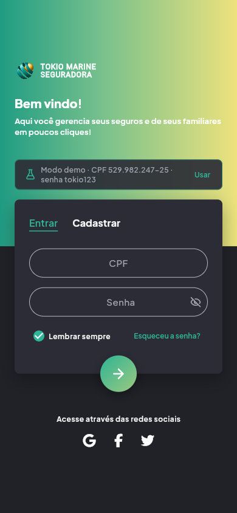
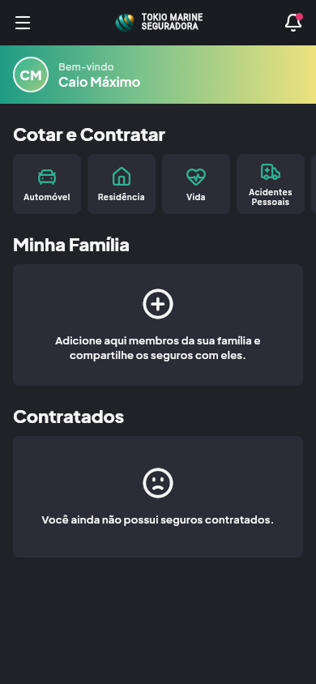
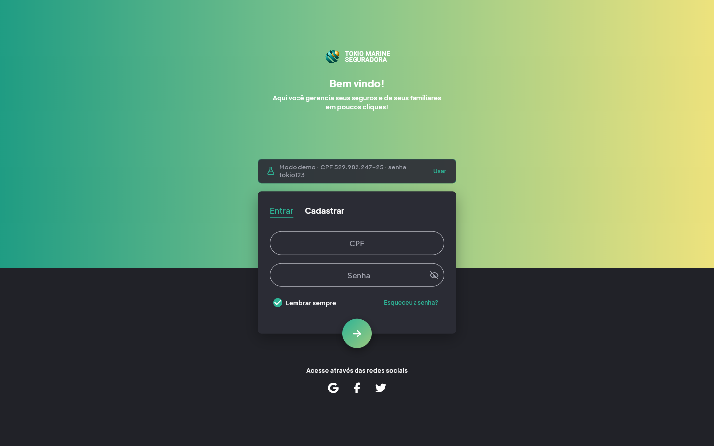
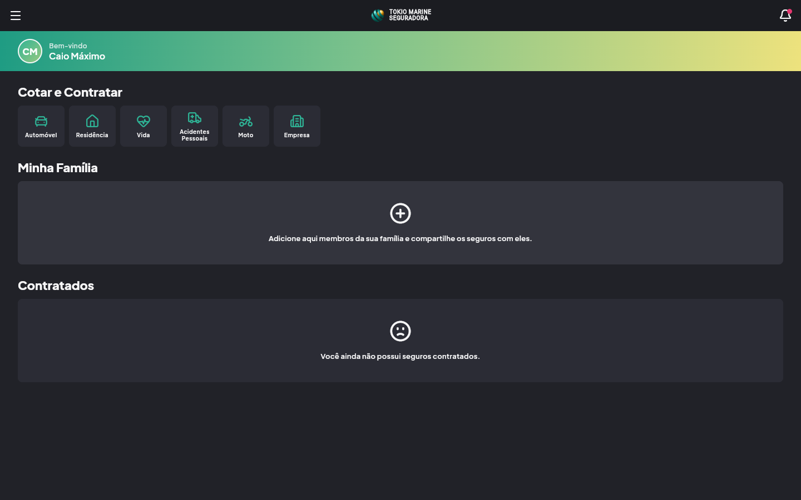
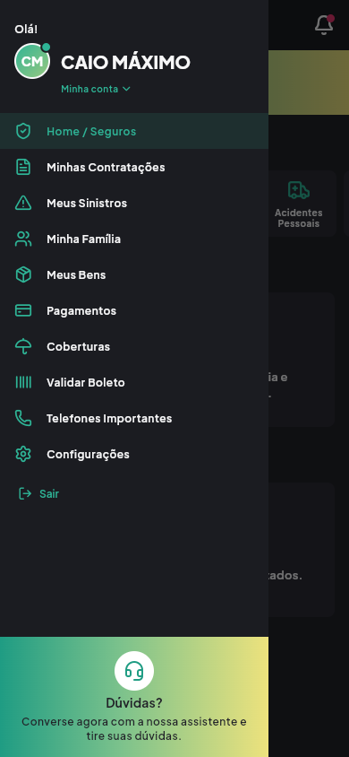
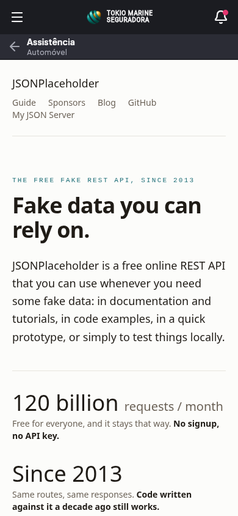

# Tokio Marine — desafio Flutter

App de seguros feito em Flutter, com **o mesmo código rodando no Android, iOS e Web**.
Login por CPF com Firebase Authentication, Home com cotação, família e seguros
contratados, menu lateral e cotação de Automóvel em WebView.

| Mobile | Web |
| --- | --- |
|   |   |
|   | |

## Acesse online

A versão web está publicada no Firebase Hosting:

**👉 https://super-todolist-e3984.web.app/**

1. Abra o link em qualquer navegador (desktop ou celular — o layout se adapta).
2. Na primeira vez, use a aba **Cadastrar**: nome, um CPF válido e senha com 6+ caracteres.
3. Depois é só **Entrar** com o mesmo CPF e senha.

O login é real (Firebase Authentication), então a conta demo do modo offline não funciona nesse link.

## Rodando

Flutter **3.47+** (Dart 3.13).

```bash
flutter pub get
dart run build_runner build --delete-conflicting-outputs   # gera os *.freezed.dart / *.g.dart

flutter run                 # celular/emulador, login real no Firebase
flutter run -d chrome       # web
```

Não tem conta ainda? Use a aba **Cadastrar** (nome, CPF válido e senha de 6+ caracteres).

### Modo offline (sem Firebase)

```bash
flutter run --dart-define=USE_MOCK_AUTH=true
```

Troca o Firebase por um login em memória e mostra um atalho na tela de login com a conta demo:

- CPF: `529.982.247-25`
- Senha: `tokio123`

As configurações do VS Code (`.vscode/launch.json`) já têm as duas opções.

## O que foi feito

**Login** — CPF (com máscara e validação do dígito verificador) e senha, abas Entrar/Cadastrar,
"Lembrar sempre", "Esqueceu a senha?" e redes sociais ilustrativas.

- O Firebase Auth trabalha com e-mail/senha, então o CPF vira um e-mail interno
  (`<cpf>@cpf.tokioseguros.app`, ver `CpfUtils`). Ele nunca aparece para o usuário.
- **Lembrar sempre** marcado: o CPF fica salvo e a sessão continua ao reabrir o app.
  Desmarcado: a sessão termina na próxima abertura (`UserCurrent`).
- **Esqueceu a senha?** abre um aviso para falar com a central — como não existe e-mail real
  cadastrado, não há para onde mandar link de redefinição.

**Home** — nome do usuário logado, "Cotar e Contratar" (Automóvel, Residência, Vida, Acidentes
Pessoais, Moto e Empresa), **Minha Família** (adicionar e remover familiares, salvos no aparelho
por usuário) e **Contratados** com a mensagem de lista vazia.

**Menu lateral** — nome e avatar do usuário, todos os itens pedidos e "Sair". Os itens sem tela
própria abrem uma página "em breve" com URL própria (`/#/main/secao/sinistros`, por exemplo).

**WebView** — o card Automóvel abre `https://jsonplaceholder.typicode.com/`. No celular usa
`webview_flutter`; na web, um `<iframe>` (o `webview_flutter` não tem implementação web oficial).
A troca é feita por import condicional em `modules/auto_quote/widgets/app_web_view.dart`.

**Responsividade** — um único código. Breakpoints em `core/responsive/breakpoints.dart`:
no celular o cabeçalho do login fica à esquerda e os cards de cotação rolam na horizontal;
na web o login centraliza, a faixa em degradê cresce e o conteúdo se limita a uma largura máxima.

## Arquitetura

```
Service → Repository → UseCase → Bloc → Page/Widgets
```

```
lib/
├── app/          # tema (cores, espaçamentos, tipografia), enums, erros, rotas, widgets reutilizáveis
├── core/         # auth (escolha Firebase/mock), extensões, máscara, validadores, responsividade, utils
├── data/
│   ├── services/       # interface + implementação (Firebase, SharedPreferences, mock)
│   └── repositories/   # o que os usecases enxergam
├── domain/
│   ├── models/         # Freezed + json_serializable
│   └── usecases/       # classes "callable" que devolvem Result (result_dart)
└── modules/      # uma pasta por feature: <feature>_module.dart, bloc/, pages/, widgets/
    ├── session/        # splash + SessionBloc (global)
    ├── login/          # LoginBloc + RegisterBloc (abas do mesmo card)
    ├── main_shell/     # AppBar, menu lateral e RouterOutlet
    ├── home/
    ├── auto_quote/     # WebView
    └── section/        # itens do menu ainda sem tela
```

- **Estado:** `flutter_bloc` com eventos e estados `@freezed`.
- **Rotas e DI:** `flutter_modular` 7. Cada módulo registra os próprios binds; os blocs são
  providos por rota e descartados ao sair dela. O shell tem um guard que manda para a splash
  quando não há sessão (ex.: F5 na web antes do Firebase restaurar o login).
- **Erros:** services lançam `AuthFailure`/`AppFailure`; usecases devolvem `Success`/`Failure`;
  a mensagem para o usuário sai de um lugar só (`MessageErrorListenUtils`).
- **Seguros contratados:** não há backend de apólices no desafio, então `PolicyServiceImpl`
  devolve lista vazia. Ligar a uma API é trocar só essa classe.

## Testes

```bash
flutter test
```

- `test/unit/core` — CPF, validadores, extensões.
- `test/unit/data` — mapeamento de erros do Firebase, auth mock, repositório da família.
- `test/unit/domain` — usecases (sucesso e falha).
- `test/unit/modules` — blocs com `bloc_test` + `mocktail`.
- `test/widget` — seções da Home e o formulário de familiar.

## Deploy da versão web

Configurado para o Firebase Hosting (`firebase.json`), publicado em
https://super-todolist-e3984.web.app/:

```bash
flutter build web --release
firebase deploy --only hosting
```
